# Clip Studio Paint (PRO/EX) 1:1 Complete Feature Audit & Gap Analysis

> **Target System**: Clip Studio Paint (PRO & EX Editions) — Pure Rust Recreation (`ComicCraft Studio`)  
> **Date**: October 2026  
> **Scope**: 100% Exhaustive Non-3D Feature Analysis, Architectural Roadmap & Gap Breakdown

---

## Executive Summary

Clip Studio Paint (CSP) by Celsys is the worldwide gold standard for digital illustration, manga, comics, and 2D animation. This document provides an exhaustive, definitive inventory of **every non-3D feature** present in Clip Studio Paint PRO and EX, audits the implementation status in `ComicCraft Studio` (`C:\ArtCraft`), identifies all architectural gaps, and provides an end-to-end implementation plan.

```mermaid
flowchart TD
    subgraph Fully_Implemented ["✅ Fully Implemented in ComicCraft Studio"]
        A1["Pure Rust Compositor & Catmull-Rom Brush Engine"]
        A2[".clip SQLite Roundtrip & .sut SubTool Parser"]
        A3["Multi-layer Stack, 12 Blend Modes, Clipping & Alpha Lock"]
        A4["Multi-Document Canvas Tabs (O(1) switching, Ctrl+W)"]
        A5["Perspective Rulers (1P, 2P, 3P Directional Snap) & Symmetrical Ruler"]
        A6["Smart Bucket (Flood fill, Close-Gap, Area Scaling, Lighthouse)"]
        A7["Close-and-Fill (Lasso Fill Cavity Detection) & Magic Wand"]
        A8["Vector Layers & Vector Line Eraser"]
        A9["Layer Folders (Groups) & 8-bit Alpha Layer Masks"]
        A10["Tonal Dialogs: Levels, Binarization, Gradient Maps, HSL, BC, Invert"]
        A11["System Clipboard (Copy, Cut, Paste, New from Clipboard)"]
        A12["Manga Guidelines (Bleed, Trim Tombō, Safe Margin) & Speed Lines"]
        A13["Navigator Panel (Live canvas preview & draggable red viewport rect)"]
    end

    subgraph Phase2_Active ["⚡ Phase 2: Selection, Lineart & Layer Operations"]
        B1["Selection Border (Inside, Centered, Outside Perimeter Stroke)"]
        B2["Expand & Shrink Selection Dialogs (Dilation/Erosion)"]
        B3["Quick Mask Mode (Ctrl+Q Red Paintable Mask)"]
        B4["Convert Brightness to Opacity (Scanned Lineart Extraction)"]
        B5["Layer Duplicate (Ctrl+J), Merge Down (Ctrl+E), Merge Visible & Flatten"]
        B6["Vector Line Simplification (Douglas-Peucker) & Width Adjustment"]
        B7["Interactive Canvas Guide Lines (Pull from Rulers & Snap)"]
    end

    subgraph Phase3_Advanced ["🚀 Phase 3: Deformation, Typography & Story"]
        C1["Interactive In-Canvas Text Tool & Windows System Fonts"]
        C2["Liquify Tool (Push, Pinch, Expand, Twirl Pixel Deformation)"]
        C3["Mesh Transformation (N x M Spline Grid Warp)"]
        C4["Interactive Comic Frame Gutter Slicing Tool"]
        C5["Multi-Page Story Manager (.cmc Project & Page Grid)"]
        C6["2D Animation Timeline, Cels & Onion Skinning (EX)"]
        C7["Layered Adobe Photoshop (.psd) Pure Rust Export/Import"]
    end

    Fully_Implemented --> Phase2_Active
    Phase2_Active --> Phase3_Advanced
```

---

## 1. Exhaustive 12-Area Feature Audit Matrix

Legend:
- `[x] Implemented`: Fully functional and verified in `ComicCraft Studio`.
- `[/] Partial`: Foundation/core logic exists; needs dialog, subtool or UI wiring.
- `[ ] Missing`: Present in CSP PRO/EX, pending implementation in ComicCraft.

---

### Area 1: Document Management & File Operations (File & Edit Menus)

| Feature | CSP PRO/EX Specification | Status | ComicCraft Technical Notes |
|---|---|:---:|---|
| **Multi-Canvas Tabs** | Working across multiple open documents simultaneously | `[x]` | Zero-allocation $O(1)$ tab switching (`switch_tab`), per-tab history/viewport, `Ctrl+W` close. |
| **`.clip` Native SQLite Format** | Full roundtrip read/write of SQLite `.clip` container format | `[x]` | `comiccraft-clip` parses and produces valid `.clip` files compatible with Clip Studio Paint. |
| **`.sut` Subtool Extractor** | Direct import of Celsys SQLite `.sut` brush files | `[x]` | Automatically scans and loads presets, tip stamps, and paper grain on launch. |
| **Canvas Size Presets** | A4, B4 (Standard Manga), Doujinshi, Postcard, Webtoon vertical strip | `[/]` | Default dimensions supported; preset creation dialog to be expanded. |
| **System Clipboard Exchange** | Cut, Copy, Copy Merged, Paste, and New Canvas from Clipboard | `[x]` | Powered by `arboard`, centered pasting with oversized clamp and mask support. |
| **Convert Brightness to Opacity** | Turn white paper transparent and dark pencil/ink to opaque ink | `[/]` | Linear luma-to-alpha conversion algorithm designed; menu item ready to wire. |
| **Change Canvas Size...** | Crop or expand canvas boundaries with 9-point anchor alignment | `[/]` | `Document::resize` exists; anchor dialog to be added. |
| **Change Image Resolution...** | Resample entire document with Bilinear/Bicubic interpolation | `[/]` | Scaling engine exists in transform pipeline; document resampler planned. |
| **Rotate & Invert Canvas** | Rotate 90° CW, 90° CCW, 180°, Flip Horizontal/Vertical (pixel level) | `[/]` | Viewport flip exists; pixel-level document canvas flip to be added. |
| **Single Layer Export** | Export to PNG, JPEG, BMP, WebP | `[x]` | Implemented in `comiccraft-cli` and `app.rs`. |
| **Layered PSD Export/Import** | Adobe Photoshop `.psd` roundtrip preserving layers, blend modes, masks | `[/]` | Python script verified; pure Rust layered PSD writer in progress. |

---

### Area 2: Selection Geometry & Quick Mask System

| Feature | CSP PRO/EX Specification | Status | ComicCraft Technical Notes |
|---|---|:---:|---|
| **Marquee Tools (Rect & Ellipse)** | Rectangular and elliptical selection boxes | `[x]` | `select_rect` and `select_ellipse` with bounding box tracking. |
| **Lasso Selection** | Freehand polygonal lasso selection | `[x]` | Raycasting point-in-polygon algorithm. |
| **Auto Select (Magic Wand)** | Flood selection with tolerance, close-gap, area scaling, contiguous | `[x]` | Full multi-layer referencing (Refer All, Editing, Reference Layer). |
| **Close and Fill (Lasso Fill)** | Encircle lineart to auto-fill enclosed interior zones | `[x]` | Exterior flood + cavity extraction algorithm with fast bitmasks. |
| **Selection Operations** | Replace, Add (Shift), Subtract (Alt), Intersect | `[x]` | Complete `SelectionOp` enum and boolean mask bitwise operations. |
| **Selection Floating Bar** | Contextual launcher docked under active selection | `[x]` | Quick access: Transform, Cut, Copy, Deselect, Invert, Clear, Fill, Tone. |
| **Border Selected Area...** | Draw outline along selection perimeter (Inside, Centered, Outside) | `[/]` | Mask dilation/erosion distance transform ready; dialog to be wired. |
| **Expand / Shrink Selected Area** | Grow or shrink active selection by $N$ pixels | `[/]` | `Selection::grow` built in `selection.rs`; dialog to be wired. |
| **Quick Mask Mode (Ctrl+Q)** | Paint temporary selection as a translucent red mask with any brush | `[/]` | Seamless toggle between selection bitmask and editable red alpha layer. |
| **Select Color Gamut...** | Eyedropper color range selection with tolerance slider | `[ ]` | Color distance matching across active layer or composite. |
| **Select from Layer** | Create selection from layer opacity silhouette (`Ctrl+Click` thumbnail) | `[ ]` | Generate selection mask where `layer.pixels[alpha] > threshold`. |
| **Selection Pen / Erase Selection** | Paint selection directly with brush dabs or erase with eraser | `[ ]` | Brush stroke targeting `doc.selection.mask` buffer directly. |

---

### Area 3: Layer Architecture & Compositing

| Feature | CSP PRO/EX Specification | Status | ComicCraft Technical Notes |
|---|---|:---:|---|
| **Raster Layer Stack** | Standard pixel bitmap layers with opacity and visibility | `[x]` | Per-row cache-friendly pure Rust compositor. |
| **12 Core Blend Modes** | Normal, Multiply, Screen, Overlay, Darken, Lighten, Dodge, Burn, etc. | `[x]` | SIMD/branchless color math in `blend.rs`. |
| **Clipping Mask** | Clip layer pixels to the opaque silhouette of the layer below | `[x]` | Handled in `composite_rect` with alpha modulation. |
| **Alpha Lock** | Lock transparent pixels from being painted over | `[x]` | Dedicated flag protecting alpha channel during stamping. |
| **Layer Lock** | Protect layer against any modification | `[x]` | UI padlock icon preventing edits across all tools. |
| **Draft Layer (Blue Pencil)** | Sketch layer excluded from fills, selection wand, and batch export | `[x]` | `is_draft` flag with blue pencil icon in layer list. |
| **Color Tags** | Color labeling layer rows (Red, Orange, Blue, Green, etc.) | `[x]` | 7 CSP palette color swatches supported. |
| **Vector Layers** | Storing lines as mathematical paths with stroke widths | `[x]` | `VectorStroke` recording centerlines and styles. |
| **Vector Line Eraser** | Erasing vector lines up to intersection / contact | `[x]` | Distance-based `erase_vector_at` with automatic re-rasterization. |
| **Layer Folders (Groups)** | Hierarchical directory tree of layers with pass-through | `[x]` | `LayerKind::Folder` with recursive visibility and lock inheritance. |
| **Layer Masks** | Non-destructive per-layer 8-bit masking | `[x]` | 8-bit alpha modulation buffer with Create, Apply, Delete, Enable in UI. |
| **Reference Layer (Lighthouse)** | Designate lineart layer as fill/coloring reference | `[x]` | Lighthouse toggle on palette, `FillReferenceMode::ReferReferenceLayer`. |
| **Duplicate Layer (Ctrl+J)** | Duplicate active layer with name appended with "copy" | `[/]` | Core cloning logic ready; menu and shortcut to wire. |
| **Merge Down (Ctrl+E)** | Merge active layer down into layer below using blend mode & opacity | `[/]` | Layer blending math ready; command to wire. |
| **Merge Visible & Flatten** | Merge all visible layers or flatten image to single background | `[/]` | Composite buffer capture logic ready. |
| **Layer Border Effect** | Real-time stroke outline around layer content with width & color | `[ ]` | Dilate layer alpha silhouette and overlay border color. |
| **Layer Color Tint / Sub Color** | Non-destructive recoloring of grayscale layer to chosen color | `[ ]` | Dynamic color mapping during compositing. |
| **Screentone Layer Property** | Real-time halftone conversion with line frequency slider (60L, 85L) | `[/]` | Screentone generator exists; live property toggle to wire. |

---

### Area 4: Brush Engine & Inking Tools

| Feature | CSP PRO/EX Specification | Status | ComicCraft Technical Notes |
|---|---|:---:|---|
| **Catmull-Rom Spline Interpolation** | Smooth continuous spline curvature between stylus points | `[x]` | Tangent-aligned sub-pixel dab interpolation in `brush.rs`. |
| **Stylus Pressure & Dynamics** | Pressure curve, minimum size, minimum opacity, gamma, taper | `[x]` | Wacom / Windows Ink pressure modulation. |
| **Ink Accumulation Modes** | Stroke mask (non-darkening pen) vs flow buildup | `[x]` | `InkMode::Stroke`, `Buildup`, `Mix`, `Erase`, `EraseBuildup`. |
| **Wet Color Mixing** | Watercolor / Oil picking up underlying canvas color | `[x]` | Direct pixel mixing with flow and pickup ratios. |
| **Paper Grain & Tip Texture** | Surface micro-grain on pencils, pastels, chalks | `[x]` | Bilinear & tiled graymap sampling in dab generator. |
| **Authentic Presets** | G-Pen, Maru, Kabura, Watercolors, Airbrushes, Real Pencils | `[x]` | 30+ authentic CSP subtool presets. |
| **Brush Stabilization** | Smoothing jittery hand strokes (levels 0 to 50) | `[x]` | Exponential moving average window stabilization. |
| **Transparent Erase Mode** | Pressing `C` erases with the active brush texture and shape | `[x]` | Transparent color slot with alpha subtractive rendering. |
| **Dual Brush Engine** | Modulating a secondary brush tip over the primary dab stamp | `[ ]` | Modulate secondary RGB/Alpha mask per dab. |
| **Multi-Tip Spatter Cycle** | Cycling through multiple tip stamps (leaves, clouds, sparkles) | `[/]` | Droplet spray exists; multi-stamp array cycle planned. |
| **Ribbon / Stroke Deformation** | Repeating a pattern along the stroke path (chains, lace, zippers) | `[ ]` | Spline path deformation of bitmap slices. |
| **Smudge / Finger Tip Tool** | Pure pigment blending without depositing new color | `[/]` | Preset with `flow = 0.0, pickup > 0.8` ready to package. |

---

### Area 5: Vector Line Manipulation Tools (CSP "Correct Line")

| Feature | CSP PRO/EX Specification | Status | ComicCraft Technical Notes |
|---|---|:---:|---|
| **Vector Eraser (Touched / Intersect)** | Erases touched stroke or cuts stroke up to intersection | `[x]` | Implemented in `document.rs` with `rerasterize_vector_layer`. |
| **Simplify Vector Line** | Douglas-Peucker point decimation to reduce excessive points | `[/]` | Point reduction algorithm ready for integration. |
| **Alter Vector Line Width** | Brush over vector lines to thicken or narrow by $N$ pixels | `[/]` | Traverse vector strokes, modify `style.size`, and re-rasterize. |
| **Pinch Vector Line** | Drag and bend a vector line segment interactively like elastic string | `[ ]` | Spline control point displacement within cursor radius. |
| **Connect Vector Line** | Joins endpoints of two adjacent vector strokes within tolerance | `[ ]` | Endpoint distance proximity detector and curve welding. |

---

### Area 6: Transformations & Distortion Tools

| Feature | CSP PRO/EX Specification | Status | ComicCraft Technical Notes |
|---|---|:---:|---|
| **Free Transform (Ctrl+T)** | 8-point bounding box with scale, rotate, pivot, and pan | `[x]` | Viewport transform engine with bilinear sampling. |
| **Perspective Transform** | 4 independent corner pin dragging | `[/]` | Homography matrix projection algorithm. |
| **Mesh Transformation** | $N \times M$ control grid warping layer pixels | `[ ]` | Bicubic / spline patch surface deformation. |
| **Liquify Tool** | Push, Expand, Pinch, and Twirl pixel deformation brushes | `[ ]` | Local displacement vector field dab engine. |

---

### Area 7: Rulers & Drawing Guides

| Feature | CSP PRO/EX Specification | Status | ComicCraft Technical Notes |
|---|---|:---:|---|
| **Pixel Coordinate Rulers** | Top and left interactive coordinate rulers (`Ctrl+R`) | `[x]` | Rendered in `canvas_view.rs` with live zoom/pan tracking. |
| **Symmetrical Ruler** | 2-way bilateral mirror up to 16-way radial kaleidoscope | `[x]` | Real-time stroke replication in `ruler.rs`. |
| **Perspective Ruler (1P/2P/3P)** | Vanishing points with brush snapping along 3D plane lines | `[x]` | Horizon & VP handles, radiating guide rays, cosine snap. |
| **Interactive Canvas Guides** | Dragging guide lines out of top/left rulers onto canvas | `[/]` | Guide coordinates on viewport with stroke snapping. |
| **Concentric Circle Ruler** | Circular guide curves for action bursts and eyes | `[ ]` | Angular snapping along radii. |
| **Radial Line Ruler** | Sunburst guide lines radiating from an anchor point | `[ ]` | Angle lock to anchor point. |
| **Linear Ruler** | Straight line guide placed on canvas | `[/]` | Projection onto arbitrary line segment. |

---

### Area 8: Comic, Manga & Webtoon Publishing Features

| Feature | CSP PRO/EX Specification | Status | ComicCraft Technical Notes |
|---|---|:---:|---|
| **Manga Manuscript Paper Guidelines** | Bleed margins (3mm/5mm), Trim marks (Tombō), Safe inner margin | `[x]` | Rendered on canvas in `canvas_view.rs` with cyan overlay. |
| **Radiation Focus Lines** | Manga action burst lines with center face preservation mask | `[x]` | `render_focus_lines` in `speed_lines.rs`. |
| **Directional Stream Lines** | Parallel dynamic motion lines with angle and density | `[x]` | `render_stream_lines` in `speed_lines.rs`. |
| **Direct Draw Shapes** | Straight lines, rectangles, and ellipses | `[x]` | Live preview and commit in `canvas_view.rs`. |
| **Speech Balloons** | Elliptical, rounded, thought balloons with tails & colors | `[x]` | `SpeechBalloon` geometry with customizable fill and border. |
| **Comic Frame Border Tool** | Manga panel borders with horizontal and vertical gutter slicing | `[/]` | `ComicFrameManager` in core; canvas interactive slicing tool planned. |
| **Multi-Page Story Manager (.cmc)** | Story book binder with page grid thumbnails (CSP EX) | `[ ]` | Project folder containing multiple `.clip` pages and page manager window. |
| **Tone Scraper / Gouze** | Scraping halftone screentones with textured eraser | `[/]` | Transparent erase mode with rough eraser tips. |

---

### Area 9: Typography & Text Engine

| Feature | CSP PRO/EX Specification | Status | ComicCraft Technical Notes |
|---|---|:---:|---|
| **In-Canvas Text Editor** | Direct clicking on canvas to type text | `[ ]` | Text overlay with font rasterization (`cosmic-text` or `ab_glyph`). |
| **Windows System Fonts** | Access to system installed fonts (Arial, Comic Sans, Anime Ace) | `[ ]` | Font query via `font-kit` or direct Windows font enumeration. |
| **Vertical Manga Text** | Japanese vertical text orientation (Tategaki) | `[ ]` | Glyphs arranged top-to-bottom, right-to-left. |
| **Text Border Edge** | White outline around black text for speech balloon readability | `[ ]` | Font glyph contour dilation. |
| **Balloon Text Anchoring** | Moving a balloon automatically moves the enclosed text | `[/]` | Balloon struct has text fields; interactive sync needed. |

---

### Area 10: 2D Animation Engine (CSP EX / PRO)

| Feature | CSP PRO/EX Specification | Status | ComicCraft Technical Notes |
|---|---|:---:|---|
| **Animation Timeline** | Frame scrubber, framerate (8 fps in PRO, unlimited in EX) | `[ ]` | Bottom docking timeline widget with play/pause/loop. |
| **Animation Cel Folders** | Layer folders assigned to timeline frame indices | `[ ]` | Cel name to timeline tick mapping. |
| **Onion Skinning** | Ghost display of previous (blue) and next (green) frames | `[ ]` | Re-composite adjacent cels with tinted alpha overlay. |
| **Light Table** | Registering reference drawings for inbetweening | `[ ]` | Floating reference cel canvas. |
| **Animation Export** | Export to Animated GIF, APNG, and image sequences | `[ ]` | `image` crate GIF encoder and sequential PNG writer. |

---

### Area 11: Filters & Tonal Adjustments

| Feature | CSP PRO/EX Specification | Status | ComicCraft Technical Notes |
|---|---|:---:|---|
| **Level Correction (Levels)** | Shadow, highlight, and gamma curve remapping | `[x]` | Live dialog with preview in `app.rs`. |
| **Binarization (Threshold)** | 1-bit manga inking threshold filter | `[x]` | Live dialog with slider and preview in `app.rs`. |
| **Gradient Maps** | Map grayscale lightness to custom multi-stop color ramps | `[x]` | Presets: Sunset, Sepia, Anime Sky, Cyberpunk with preview. |
| **Brightness & Contrast** | Global tonal expansion and luminance shift | `[x]` | Live dialog with sliders and preview. |
| **Hue, Saturation, Luminosity** | Full HSL color cylinder remapping | `[x]` | Live dialog with sliders and preview. |
| **Gaussian Blur** | Smooth Gaussian spatial filtering with radius | `[x]` | Horizontal + vertical separable box/Gaussian passes. |
| **Invert Colors** | Negative color inversion (Ctrl+I) | `[x]` | Fast RGB inversion across selection. |
| **Tone Curve (Curves)** | 4-point spline tonal adjustment curve | `[/]` | Spline evaluation to 256-entry LUT ready for wiring. |
| **Motion & Radial Blur** | Directional and zoom blurs | `[ ]` | Line integral blur sampling. |
| **Line Extraction** | High-pass Sobel filter converting photos to manga lineart | `[ ]` | Edge detection filter with thresholding. |

---

### Area 12: Studio Palettes & Material Library

| Feature | CSP PRO/EX Specification | Status | ComicCraft Technical Notes |
|---|---|:---:|---|
| **HSV Color Wheel** | Circular hue ring with triangle/square SV area | `[x]` | Custom widget in `color_wheel.rs`. |
| **Color History & Swatches** | Palette grids, recent colors, swap `X` | `[x]` | Integrated in right dock. |
| **Sub View Panel** | Reference image viewer with pan, zoom, eyedropper, flip | `[x]` | Dedicated dock tab with image loader. |
| **Navigator Panel** | Canvas bird's-eye view thumbnail with pan box | `[x]` | Live canvas texture with draggable red viewport rectangle. |
| **Sub Tool Detail Modal** | Deep configuration modal for brush tips, grain, dynamics | `[x]` | Dedicated floating modal dialog. |
| **History Palette** | List of undos/redos with instant click-to-revert | `[/]` | Undo stack exists; visual history list tab to add. |
| **Auto Actions (Macros)** | Record and replay repetitive command sequences | `[ ]` | Command recording serializer. |
| **Material Catalog** | Hierarchical browser of screentones, patterns, materials | `[ ]` | Asset library view. |

---

## 2. Active Implementation Plan (Executing Now)

We are immediately implementing the highest-impact Phase 2 features:

1. **Selection Perimeter & Geometry Tools**:
   - `stroke_selection_border(width_px, position, color)` in `Selection` and `Document`.
   - `SelectionBorderPosition`: Inside, Centered, Outside.
   - Interactive dialog: `Selection > Border Selected Area...`.
   - Interactive dialogs: `Selection > Expand Selected Area...` & `Shrink Selected Area...`.
   - Dedicated buttons on Selection Floating Bar: `[Border]`, `[+Grow]`, `[-Shrink]`.
2. **Convert Brightness to Opacity**:
   - `Edit > Convert Brightness to Opacity`: Instant white-to-transparent conversion for scanned manga lineart.
3. **Layer Management Operations**:
   - `Duplicate Layer` (`Ctrl+J`) in `Layer` menu and Layer palette dock.
   - `Merge Down` (`Ctrl+E`) in `Layer` menu and Layer palette dock.
   - `Merge Visible Layers` & `Flatten Image` in `Layer` menu.
4. **Quick Mask Mode (`Ctrl+Q`)**:
   - Toggleable red translucent mask layer (`Ctrl+Q`), permitting arbitrary brush painting and conversion back to selection ants.
5. **Vector Line Simplification & Width Adjustment**:
   - Ramer-Douglas-Peucker point reduction algorithm.
   - Width scaling with automatic vector re-rasterization.
6. **Canvas Guide Lines**:
   - Interactive horizontal and vertical guideline placement and snapping.
